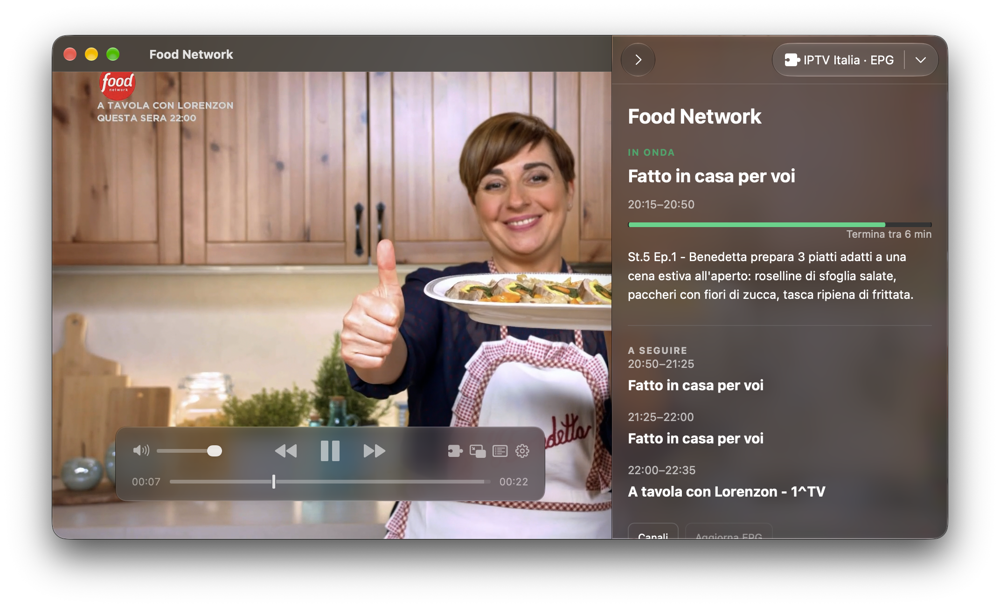
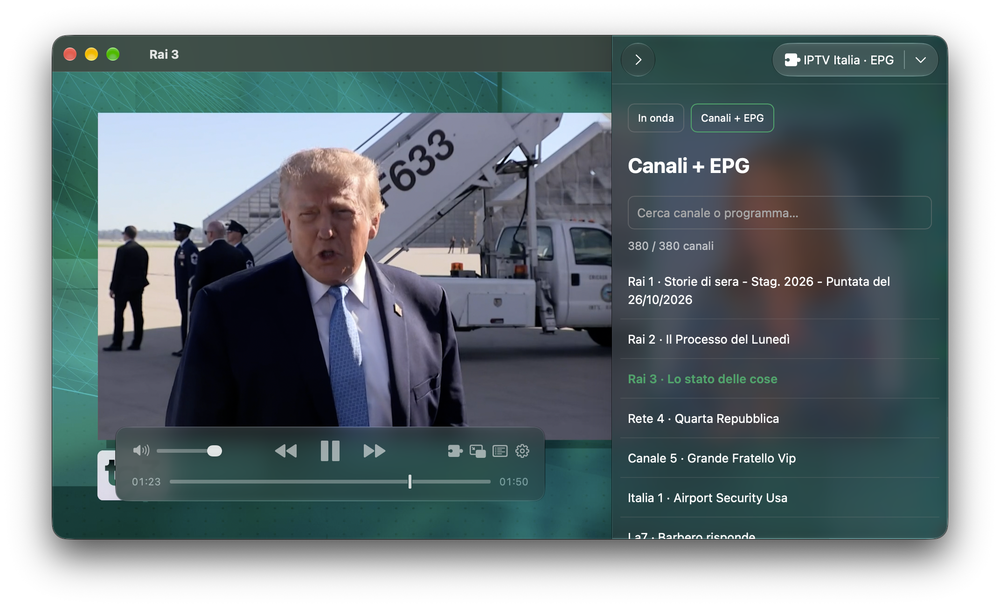

# IPTV Italia per IINA

**La TV italiana in IINA, con un clic.**

Un plugin per [IINA](https://iina.io/) che integra i canali italiani in chiaro di [peppenamir/iptv_italia](https://forgejo.it/peppenamir/iptv_italia) e la guida TV di [EPGSHARE01](https://epgshare01.online/). Puoi anche usare una playlist IPTV personale e una o più guide XMLTV, con abbinamento automatico dei canali.

Una volta installato, scegli **Plugin → Apri IPTV Italia**: un clic apre la playlist e mostra le informazioni del programma accanto al video. Non devi cercare o importare manualmente i link dei canali e dell'EPG.

## Cosa offre

- **In onda:** programma corrente, descrizione, orari, avanzamento e programmi successivi durante la visione.
- **Canali + EPG:** elenco cliccabile con il programma accanto al nome del canale, ricerca e aggiornamento automatico dei titoli.
- **Guida TV completa:** palinsesto disponibile fino a tre giorni, consultabile in una finestra separata.
- **Sorgenti personalizzate:** playlist M3U/M3U8 e guide XMLTV o XMLTV.gz da URL HTTP(S) o file locali, salvate tra un avvio e l’altro.
- **Abbinamento automatico:** usa `tvg-id`, `tvg-name` e nome del canale, riconoscendo accenti, punteggiatura e varianti HD/SD. I nomi ambigui restano da correggere manualmente nella guida.
- **EPG dalla playlist:** se non indichi guide, cerca automaticamente le sorgenti nell’intestazione M3U (`x-tvg-url`, `url-tvg`, `tvg-url`).
- **Consumo contenuto:** cache EPG di sei ore, un solo timer per i cambi di programma e aggiornamento delle sole etichette cambiate, senza download per ogni canale.

## Anteprima

**Il programma in onda, accanto al video.**

**I canali e i programmi in onda, in un unico elenco.**

## Installazione

Servono **IINA 1.5.0 su macOS** e una connessione Internet. Per la guida TV serve anche **Python 3**, installabile con una normale procedura grafica. Non servono Terminale, Xcode o strumenti di sviluppo.

1. **[Scarica il plugin pronto da installare](https://github.com/smastrom/iina-iptv-italia/releases/download/v1.0.0/IPTV-Italia-1.0.0.iinaplgz)**. Il download del file `.iinaplgz` parte direttamente.
2. Apri il file con IINA: doppio clic oppure **Apri con → IINA** dal Finder.
3. Abilita **IPTV Italia** nelle impostazioni di IINA, nella sezione plugin/componenti aggiuntivi, e riavvia il player.
4. Scegli **Plugin → Apri IPTV Italia**.

Il pacchetto e le note sono disponibili nella [pagina della release](https://github.com/smastrom/iina-iptv-italia/releases/tag/v1.0.0).

**Se manca Python:** scarica l'installer **macOS 64-bit universal2** di una versione stabile compatibile dal [sito ufficiale](https://www.python.org/downloads/macos/), apri il file `.pkg`, completa l'installazione con le opzioni predefinite e riavvia IINA. Il plugin riconosce automaticamente l'interprete; Python non è incluso nel pacchetto.

## Utilizzo

Nella barra laterale passa da **In onda** a **Canali + EPG**. Fai clic su un canale per riprodurlo: le informazioni seguono automaticamente la selezione e gli orari sono quelli del Mac.

Durante la riproduzione di un canale della playlist, dal menu **Plugin** puoi anche aprire direttamente:

| Comando | Vista |
| --- | --- |
| **EPG del canale corrente** | Informazioni sul programma in onda. |
| **Canali con EPG** | Elenco dei canali con i programmi attuali. |
| **Guida TV (EPG)…** | Palinsesto completo in una finestra separata. |
| **Sorgenti IPTV / EPG…** | Configurazione della playlist e delle guide personali. |

I comandi **Canali con EPG** ed **EPG del canale corrente** compaiono solo mentre è aperto un canale IPTV. La guida completa e le sorgenti restano disponibili anche all’avvio.

**Aggiorna EPG** forza un nuovo download della guida. **Playlist IINA** apre l'elenco nativo del player: i titoli dei programmi sono disponibili nell'elenco **Canali + EPG** del plugin, perché IINA 1.5.0 non permette di rinominare direttamente le righe della playlist nativa.

### Playlist e guide personali

1. Apri **Plugin → Sorgenti IPTV / EPG…**, oppure **Sorgenti…** nella barra laterale.
2. Inserisci l’URL della playlist M3U/M3U8. Sono accettati anche percorsi come `/Users/nome/TV/lista.m3u`, `~/TV/lista.m3u` e `file:///Users/nome/TV/lista.m3u`.
3. Inserisci le guide XMLTV o XMLTV.gz, **una per riga**, fino a 16. Lascia il campo vuoto per rilevarle dalla playlist. Le sorgenti EPG relative nell’intestazione vengono risolte rispetto alla playlist.
4. Premi **Salva sorgenti** per caricare i canali e l’EPG, poi **Apri playlist salvata** per riprodurre il nuovo elenco. Anche **Apri IPTV Italia** usa la playlist salvata.

Per tornare alla configurazione inclusa, premi **Usa fonti italiane** e poi **Salva sorgenti**. Le finestre già aperte mantengono la propria playlist di riproduzione: apri quella salvata dopo aver cambiato sorgente.

L’abbinamento dà priorità al `tvg-id` esatto, poi confronta i nomi e infine le varianti normalizzate. Con più guide, per uno stesso ID viene usato il primo palinsesto disponibile. Un nome che corrisponde a più ID non viene scelto automaticamente.

Per correggere un abbinamento, apri **Guida TV (EPG)…**, espandi il canale, cerca un nome o ID nel campo **Abbinamento EPG** e premi **Applica ID**. **Automatico** rimuove la correzione; **Disattiva EPG** esclude il canale dalla guida. Le correzioni sono salvate per URL dello stream e vengono azzerate quando cambi playlist.

La cache dura sei ore ed è separata per sorgente. Una correzione manuale riusa i feed già letti; **Aggiorna EPG** ricarica anche i file locali modificati. Se una guida non è disponibile, puoi comunque usare i canali e gli altri feed. Il plugin segnala il problema e riprova; quando possibile usa la cache della stessa configurazione.

## Fonti e crediti

- **Canali predefiniti:** [playlist di peppenamir/iptv_italia](https://forgejo.it/peppenamir/iptv_italia/raw/branch/main/lista.m3u).
- **Guida TV predefinita:** [feed XMLTV Italia di EPGSHARE01](https://epgshare01.online/epgshare01/epg_ripper_IT1.xml.gz).
- **Player:** [IINA](https://iina.io/) e le sue [API per i plugin](https://docs.iina.io/).

Disponibilità dei canali e copertura EPG dipendono dalle fonti: per alcuni canali il palinsesto può non essere disponibile. Questo progetto contiene il plugin, non gli stream o i cataloghi delle emittenti.

Progetto realizzato con l’aiuto dell’IA e pubblicato così com’è.
